# Results: early-cycle battery life prediction, ICA + machine learning

Generated from the trained models in `backend/artifacts/` by `tools/make_report.py`. Every number is cross-validated or held-out; none is a training-set score.

## 1. Replicating the paper's protocol (MIT-Stanford data)

The paper's evaluation protocol was re-run: stratified split across cycle-life terciles (80 train / 58 test, the paper's 58%/42%), standardised inputs, 5-fold grid search on the training set, raw cycle life as the target, four models, R2 / RMSE / MAE / MAPE. Run over 10 random splits.

| Model | Paper R2 | Ours R2 (paper protocol, mean ± sd) | Ours R2 (improved, mean ± sd) | Paper MAPE | Ours MAPE (paper protocol) | Ours MAPE (improved) |
|---|---|---|---|---|---|---|
| XGBoost | 0.507 | 0.636 ± 0.070 | 0.616 ± 0.087 | 16.1% | 19.0% | 16.7% |
| Random Forest | 0.402 | 0.543 ± 0.107 | 0.579 ± 0.062 | 17.2% | 22.1% | 18.6% |
| Gradient Boosting | 0.371 | 0.600 ± 0.129 | 0.637 ± 0.090 | 18.2% | 19.9% | 17.1% |
| SVR | 0.164 | 0.401 ± 0.029 | 0.617 ± 0.087 | 22.6% | 21.1% | 17.6% |

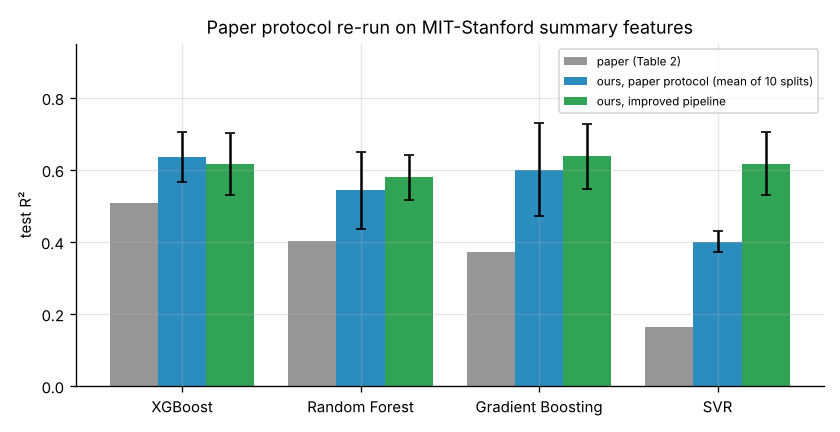
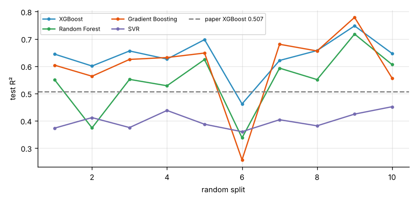

**Reading it honestly**
- The model ranking by mean R2 here is XGBoost > Gradient Boosting > Random Forest > SVR; the paper's is XGBoost > Random Forest > Gradient Boosting > SVR. XGBoost best and SVR worst reproduce; the middle two swap within split noise.
- R2 is higher than the paper's for all four models, but this is **not a like-for-like comparison**: we have 138 cells (paper: 124) and 40 per-cycle summary features (paper: 108 ICA features from raw voltage-capacity curves). The numbers are protocol-matched, not feature-matched.
- A single split is a noisy draw (XGBoost R2 ranges 0.46 to 0.75 across splits), so the paper's 0.507 and our first-split 0.64 both carry real uncertainty.
- Our improved pipeline (log target, fixed regularised hyperparameters) lowers MAPE for 4 of 4 models and raises mean R2 for 3 of 4 (largest gain: SVR); where it does not help (XGBoost: 0.64 vs 0.62) the difference is within split noise.
- RMSE is larger than the paper's (195 vs 137 cycles for XGBoost) partly because our cells span up to 1,935 cycles.
- **Not reproducible with the data we have:** the paper's 108 ICA features and its claim that mid-charge-voltage features dominate importance. That requires the raw MIT-Stanford voltage-capacity curves (see `tools/convert_severson.py` for the route once they are available).

## 2. How far the MIT-Stanford accuracy generalises

| Validation | Gradient Boosting R2 |
|---|---|
| Random-split CV (5-fold x 3) | 0.69 |
| Leave-protocol-out (whole charging protocols held out) | 0.53 |
| Leave-batch-out (mean of 3 batches) | -4.96 |

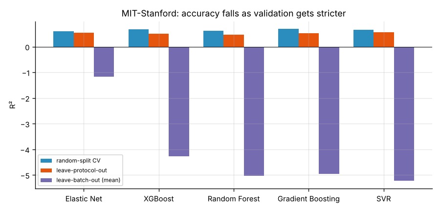

Accuracy falls as validation gets stricter; on a whole unseen batch every model scores below zero. Nominal 80% intervals cover 68% of cells. Tier (GOOD / NEEDS TESTING / POOR) agreement is 88%.

## 3. The paper's method on real ICA: NASA PCoE cells (state of health)

Real dQ/dV from the constant-current charge, plus charge/constant-voltage and temperature features, each also as a change from the cell's own first 5 cycles. 21 of 34 cells pass a quality gate. Leave-battery-out CV:

| Model | R2 | RMSE (SOH points) |
|---|---|---|
| Elastic Net | 0.76 ± 0.01 | 4.49 |
| XGBoost | 0.80 ± 0.01 | 4.08 |
| Random Forest | 0.81 ± 0.01 | 4.01 |
| Gradient Boosting | 0.79 ± 0.01 | 4.21 |
| SVR | 0.62 ± 0.02 | 5.69 |

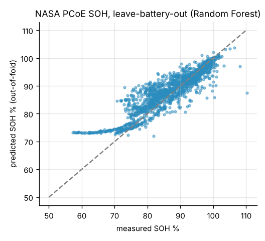
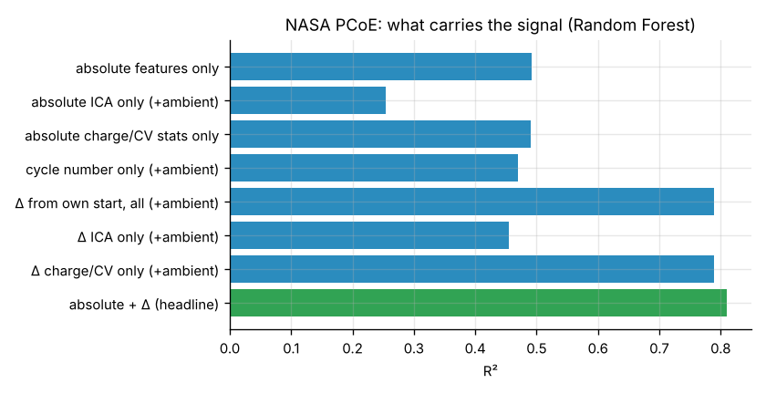
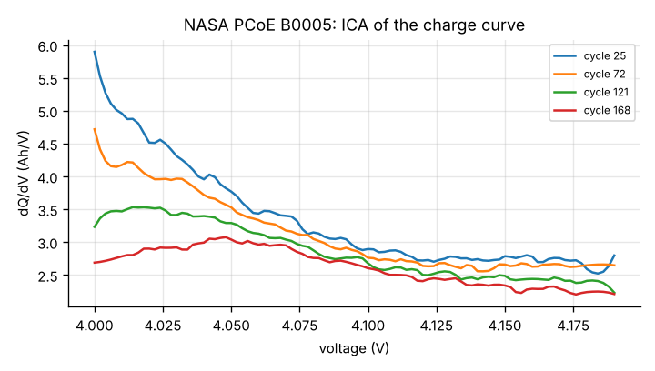

- Most of the signal comes from changes in charge time and constant-voltage-phase behaviour; absolute ICA features alone are weak (R2 0.25).
- Remaining life on this data does **not** beat a cycle-count baseline, and the paper's first-50-cycles life prediction is not trainable here (only 10 usable cells reach 80% SOH, 3 of them before cycle 50).

## 4. Accelerated-life battery packs (26 packs, 9,614 cycles)

| Task | Best model | R2 | Error | Baseline (cycle count + load) |
|---|---|---|---|---|
| SOH from charge-side signals | Random Forest | 0.87 | 2.7 SOH points | R2 0.71 |
| Remaining life to 80% capacity (16 packs) | XGBoost | 0.74 | 77 cycles | R2 0.18 |
| Second-life transfer (3 packs) | Random Forest | 0.24 | 5.4 SOH points | n/a |

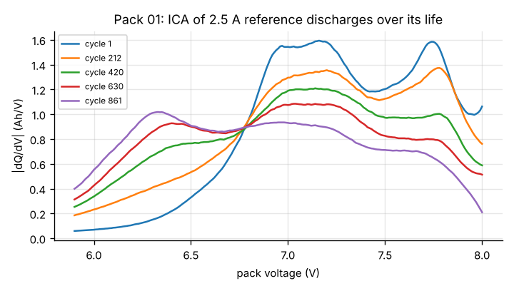
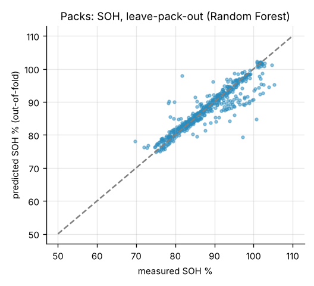
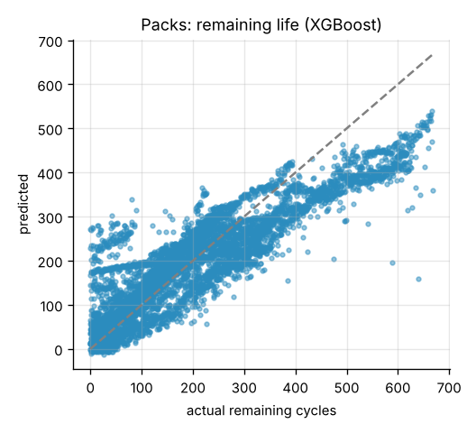
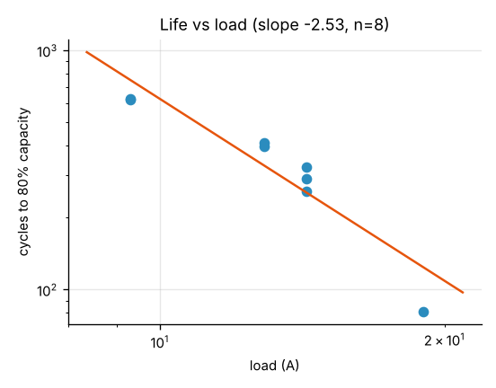

Life falls roughly as load^-2.53 (only 8 packs reached 80%; leave-one-out error 36%). Remaining life beats its baseline but underestimates the longest-lived packs. Second-life transfer is weak.

## 5. Reference cell

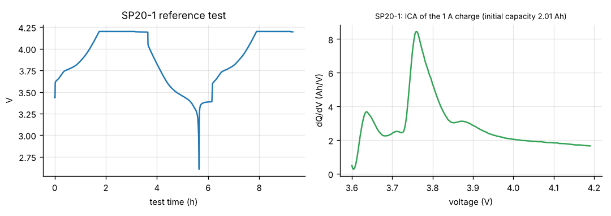

The SP20-1 workbook is one reference test: initial capacity 2.01 Ah. It is shown as reference data, not used for training.

## What is and is not claimed
- Replicated: the paper's evaluation protocol and four-model comparison, on our data.
- Not replicated: the paper's exact numbers, which need its 124 cells and raw-curve ICA features.
- All other claims above are supported by cross-validated results in `backend/artifacts/` and visible in the web app.
